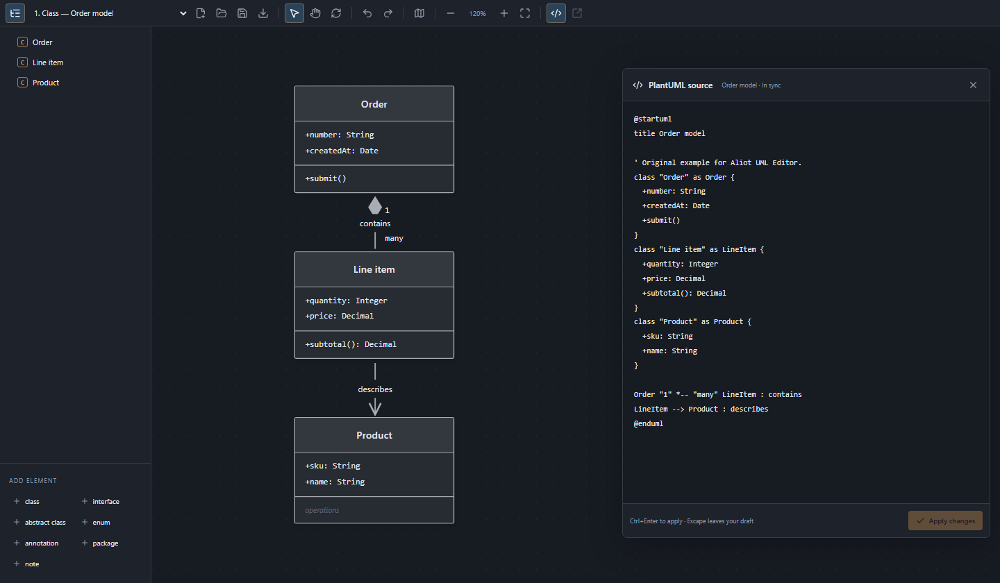
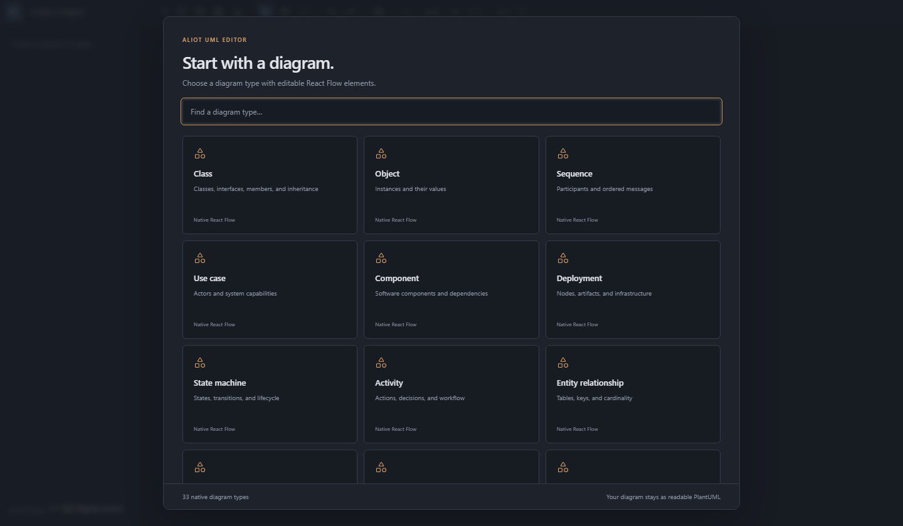
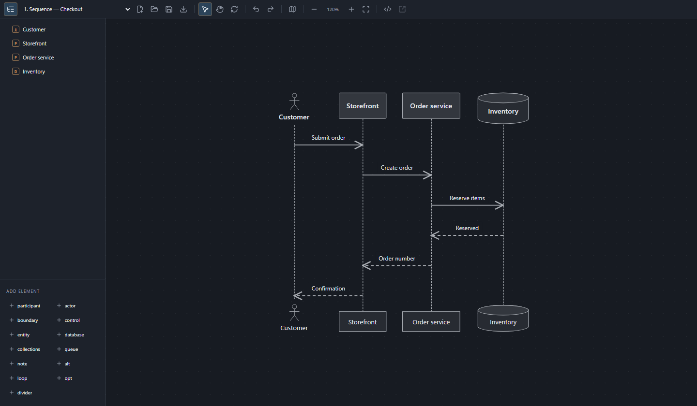
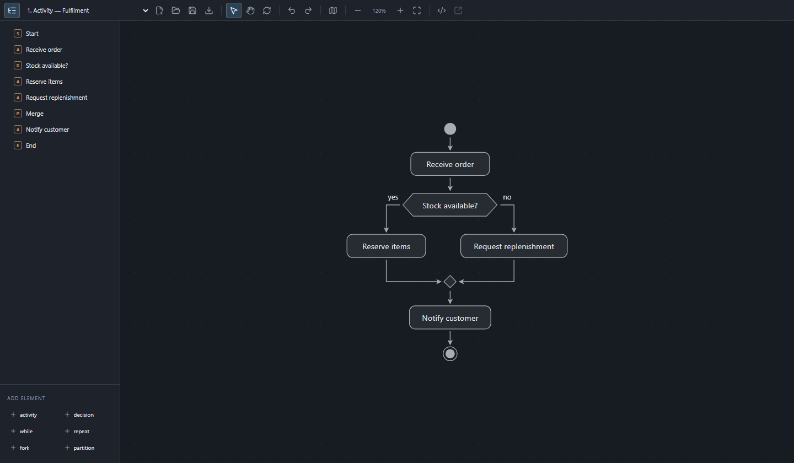
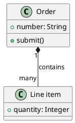

# Aliot UML Editor

**Edit UML visually. Keep your PlantUML source.**

Create and edit diagrams directly in VS Code: rename a class, connect components, rearrange a workflow, or change the source. Aliot UML Editor keeps the canvas and supported PlantUML syntax in sync, with editable shapes instead of a rendered image.

**33 diagram families · Visual and source editing · Portable layouts · MIT licensed**



*The actual editor, shown in its standalone preview with the bundled Order model example.*

## Why Aliot UML Editor?

- **Work directly on the diagram.** Double-click names and members, add elements from the canvas menu, and drag between connection handles for supported relationships.
- **Keep readable source.** Edit `.puml` files or use the source panel inside the canvas. Source edits update the diagram; visual edits update the corresponding source.
- **Start from a template.** Choose from 33 diagram families in a searchable gallery, then switch between multiple diagram blocks in the same file.
- **Save your layout with your model.** Portable `.aliotuml` documents contain the PlantUML source, manual positions, and saved viewports in one readable JSON file.
- **Use familiar editor controls.** Native VS Code save, undo, redo, and unsaved-change handling, plus outline navigation, a minimap, zoom, fit, and **Re-layout**.
- **Render locally.** No Java, Graphviz installation, PlantUML server, or remote rendering service is required.

## Get started

Requires **VS Code 1.104.0 or later** on a desktop or remote extension host.

1. Install **Aliot UML Editor** from the Extensions view. For a downloaded `.vsix`, use **Extensions: Install from VSIX…** from the Command Palette.
2. Run **Aliot UML: New Diagram** and choose a template, or open an existing `.puml`, `.plantuml`, `.pu`, `.iuml`, or `.aliotuml` file.
3. Double-click a label or compartment to edit it. Right-click empty canvas to add an element. Drag connection handles to create supported relationships.
4. Save with **Ctrl+S** / **Cmd+S**. Choose **Save Aliot diagram** to keep source and positions together, or **Export PlantUML** to write a plain `.puml` copy.

If a file opens as text, right-click its editor tab and choose **Reopen Editor With… → Aliot UML Editor**, or run **Aliot UML: Open Diagram**.



*Pick a starter and make it your own. The gallery includes 33 native diagram types.*

## From architecture to workflows

Model a checkout conversation, sketch a service boundary, explore a data structure, or map a release plan. Each family has its own native notation and editing tools.

| Area | Diagram families |
| --- | --- |
| UML and data modeling | Class, object, sequence, use case, component, deployment, state, activity, entity relationship, Chen ER |
| Architecture and infrastructure | C4, ArchiMate, network, DOT |
| Planning and organization | Mind map, work breakdown structure, Gantt, chronology, board, Git history |
| Data and interfaces | JSON, YAML, Salt wireframes, files |
| Signals, languages, and formulas | Timing, SDL, EBNF, regex, math, LaTeX |
| Charts and ASCII diagrams | Chart, JCCKit, Ditaa |



*Sequence diagrams keep participants, messages, and lifelines on the canvas.*



*Activity diagrams arrange actions, decisions, and merges around the control flow.*

## Visual editing and source, together

Open **Edit PlantUML source in canvas** from the toolbar to work on the current diagram's text. Apply a source draft with **Apply** or **Ctrl+Enter** / **Cmd+Enter**. For plain PlantUML files, **Source file** opens the text document alongside the diagram.

Try this in a new `order.puml` file:



Double-click **Order** to rename it, edit its members, or move the shapes. Use **Re-layout** to clear manual placements and arrange the current diagram again.

## Choose how to save

| Format | What it stores | Best for |
| --- | --- | --- |
| `.puml`, `.plantuml`, `.pu`, `.iuml` | Plain PlantUML source; manual placement stays in the current VS Code workspace | Text-based workflows and existing PlantUML projects |
| `.aliotuml` | PlantUML source, manual positions, and saved viewports in one versioned JSON document | Sharing or committing a diagram with its layout |

**Export PlantUML** exports the source only. Manual canvas positions are not encoded in PlantUML. A saved portable copy is an independent document; it does not create an automatically synchronized pair of files.

## Canvas shortcuts

| Action | Gesture |
| --- | --- |
| Rename | Double-click a name, or select and press **F2** |
| Edit members or properties | Double-click the compartment or shape content |
| Add an element or child | Right-click the canvas or a supported container |
| Edit a relationship | Double-click its connector or label |
| Reorder a sequence message | Drag its line or label up/down; focused labels also accept **↑** / **↓** |
| Move or resize a sequence divider | Drag its label; select it and drag the left/right resize handle |
| Select / Hand tool | **V** / **H** |
| Temporary Hand tool | Hold **Space** |
| Pan in Select mode | Mouse wheel; **Shift+wheel** horizontally; middle-button drag |
| Zoom in Select mode | **Ctrl+wheel** / **Cmd+wheel** |
| Fit diagram | **F** |

Connections in structured activities, trees, and networks follow their source structure. Gantt tasks and chronology events change their dates when dragged.

Sequence lifelines offer connection points at the message rows. Drag between lifelines at the desired row to insert a message there. Moving messages or dividers between rows updates their source order; divider widths and horizontal placement are saved with the layout.

## PlantUML compatibility

**Preview release.** Aliot UML Editor implements a native subset of PlantUML; support for a diagram family does not mean complete language compatibility or identical rendering to PlantUML. Unsupported constructs retain their source and produce diagnostics.

Common labels, relationships, nested groups, and selected styles are supported. Full styling, arbitrary preprocessing, custom sprites, and external includes are not evaluated. Known C4 and ArchiMate macros are interpreted locally. Diagram layout and appearance use the native editor.

Desktop and remote VS Code hosts are supported. A browser extension bundle for **vscode.dev** is not currently provided. Image and PDF export are not currently offered; **Export PlantUML** exports source.

See the [native editing reference](docs/native-editing.md) for the scope of each family and the [portable file format](docs/aliot-file-format.md) for `.aliotuml` details. The [bundled examples](examples/all-native.puml) include all 33 starter diagrams.

## Development

```sh
npm ci
npm run check
npm run preview
```

Press **F5** to launch an Extension Development Host, or open the standalone preview at `http://127.0.0.1:4173`. To edit a real file in the browser preview, run `npm run preview -- --model examples/portable.aliotuml`.

See [Contributing](CONTRIBUTING.md) for architecture and test commands, and the [Changelog](CHANGELOG.md) for release notes.

## License

[MIT](LICENSE) — free to use, modify, and distribute, including commercially, under the license terms. Copyright © 2026 Aliot UML Editor contributors.

Bundled dependencies retain their own licenses. See [Third-party notices](THIRD_PARTY_NOTICES.md) and [Third-party license texts](THIRD_PARTY_LICENSES.txt).
